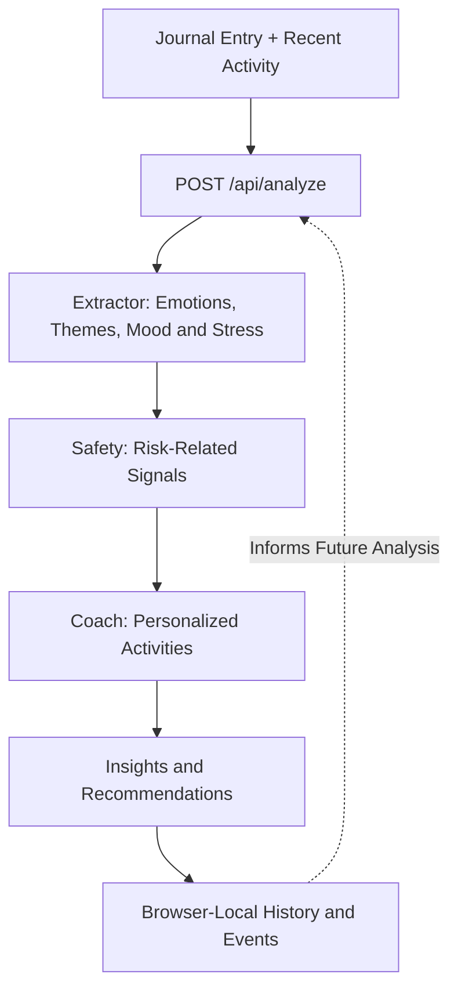

<div align="center">

# Your Journal Companion

**A reflection-first journaling app that turns daily writing into personalized insights and small, actionable next steps.**

Built with Next.js, TypeScript, Tailwind CSS, and an AI-assisted, three-stage analysis workflow.

[**Try the live app**](https://yourjournalcompanion.vercel.app/) · [**View source**](https://github.com/shivanikadirgamarajah/Your-Journal-Companion)

</div>

---

## Overview

Your Journal Companion helps you reflect on your day, notice recurring themes, and translate your journal entries into manageable activities. Instead of stopping at a text entry, the app offers mood and stress estimates, a next-day reflection prompt, and recommendations informed by your recent activity history.

The project is a **prototype**, not a clinical or diagnostic tool.

## Features

- **Journal entries:** Write, save, revisit, and delete entries, with timestamps and word counts.
- **AI-assisted insights:** Analyze an entry to receive estimated mood and stress scores, emotions, and themes.
- **Three-stage analysis:** Separate AI steps extract signals, assess safety-related language, and suggest practical activities.
- **Personalized recommendations:** Receive 3–5 suggested activities and a prompt for tomorrow; suggestions can use prior activity events to adapt to what you start or finish.
- **Activity tracking:** Mark recommendations as started or completed. Completed items are replaced from a small built-in activity pool when available.
- **Reflection trends:** View average mood and stress across the most recent seven analyses.
- **Exportable summary:** Download the latest analysis as a plain-text file.
- **Local event dashboard:** Inspect tracked interactions and completion counts on the Events page.
- **Safety guidance:** Display non-diagnostic guidance and links to crisis-support information where relevant.

## Live Demo

**https://yourjournalcompanion.vercel.app/**

### How to Use

1. Open **Journal** and write about your day.
2. Select **Save entry** to keep the entry, or **Analyze entry** to save it and request AI feedback.
3. Visit **Insights** to review the analysis, recent averages, and a follow-up prompt.
4. Open **Recommendations** to start and complete suggested activities.
5. Return to your journal over time. Recent activity events can help inform subsequent recommendations.

> **Note:** You can save entries without an AI key when running locally, but **Analyze entry** needs a working OpenRouter API key configured on the server.

## Tech Stack

| Layer | Technology |
| --- | --- |
| Framework | Next.js 16 (App Router) |
| Language | TypeScript |
| UI | React 19, Tailwind CSS 4 |
| AI Integration | OpenRouter API (`openai/gpt-4o-mini`) |
| Persistence | Browser `localStorage` |
| Deployment | Vercel |

## Architecture

When a user analyzes an entry, the application processes the journal text through three sequential AI stages.



### Three-Stage AI Pipeline

**1. Extractor**

Analyzes the journal entry to identify:
- Emotional patterns
- Mood and stress estimates
- Recurring themes
- Relevant contextual observations

**2. Safety**

Evaluates risk-related language and determines whether additional support resources should be displayed.

**3. Coach**

Generates personalized recommendations based on:
- The current journal analysis
- Recent activity history
- Previously completed recommendations
- User interaction patterns

The analysis is intended for personal reflection rather than clinical assessment.

## Getting Started

### Prerequisites

Ensure you have:

- Node.js 20.9 or later
- npm
- An [OpenRouter](https://openrouter.ai/) API key

### 1. Clone the Repository

```bash
git clone https://github.com/shivanikadirgamarajah/Your-Journal-Companion.git

cd Your-Journal-Companion
```

### 2. Install Dependencies

```bash
npm ci
```

### 3. Configure Environment Variables

Create a `.env.local` file in the project root.

```env
OPENROUTER_API_KEY=your_openrouter_api_key_here
```

**Important:** Never commit API keys or expose them through `NEXT_PUBLIC_` environment variables.

### 4. Run the Development Server

```bash
npm run dev
```

Open:

http://localhost:3000

### Available Commands

| Command | Description |
| --- | --- |
| `npm run dev` | Start development server |
| `npm run build` | Create production build |
| `npm run start` | Start production server |
| `npm run lint` | Run ESLint |

## Project Structure

```text
app/
├── page.tsx
├── journal/
├── insights/
├── recommendations/
├── admin/
│   └── events/
└── api/
    └── analyze/
        └── route.ts

components/
├── Shared UI components
└── Safety components

lib/
├── JournalStore.ts
├── analysisStore.ts
├── events.ts
├── eventFeatures.ts
└── recsStore.ts

public/
```

### Core Modules

| Module | Responsibility |
| --- | --- |
| `JournalStore.ts` | Journal entry persistence |
| `analysisStore.ts` | Analysis results and history |
| `events.ts` | Interaction event tracking |
| `eventFeatures.ts` | Activity-based personalization |
| `recsStore.ts` | Recommendation tracking |
| `api/analyze/route.ts` | Server-side AI analysis |

## Privacy and Data Storage

Your Journal Companion currently uses browser-local storage rather than a centralized database.

- Journal entries are stored in browser `localStorage`.
- Analysis history and recommendations are stored locally.
- No account registration is required.
- Clearing browser site data may remove saved entries.
- Data is not automatically synchronized between devices.

### AI Processing

When users request AI analysis, the application sends relevant journal content and interaction information to its server, which communicates with OpenRouter.

Journal content is therefore **not guaranteed to remain exclusively on the user's device**.

Users should avoid submitting highly sensitive information without reviewing the external AI provider's privacy policies.

## Deployment

The application can be deployed using [Vercel](https://vercel.com/).

1. Push the project to GitHub.
2. Import the repository into Vercel.
3. Configure the `OPENROUTER_API_KEY` environment variable.
4. Deploy the application.

Vercel automatically detects the Next.js framework.

## Future Improvements

Potential improvements include:

- User authentication and secure accounts
- Encrypted journal storage
- Cross-device synchronization
- More advanced mood visualization
- Improved AI response validation
- Automated unit and integration tests
- Enhanced privacy controls
- Additional personalized activity recommendations

## Disclaimer

Your Journal Companion is a personal reflection and habit-building application.

AI-generated insights are estimates and should not be interpreted as medical diagnoses, professional mental-health advice, or validated psychological assessments.

The application is not a substitute for qualified professional support or emergency services.

## Author

**Shivani Kadirgamarajah**

GitHub: [@shivanikadirgamarajah](https://github.com/shivanikadirgamarajah)

---

<div align="center">

**Built to make everyday reflection more meaningful.**

</div>

